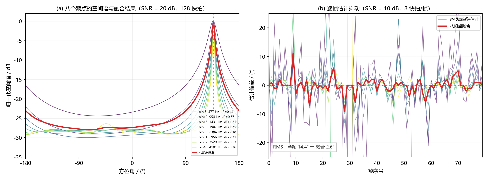
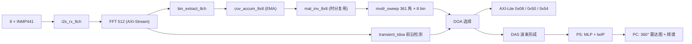

# 基于 ZYNQ-7020 的八元圆周阵列声学雷达

一套面向 **声源定位 + 声源分类 + 定向拾音** 的 ZYNQ 软硬协同系统：8 个 INMP441
组成均匀圆周阵列，PL 在 50 MHz 单时钟域内完成 I2S 采集、512 点 FFT、宽带
MVDR 测向、DAS 波束形成与瞬态 TDOA；PS 跑轻量 MLP 分类与 lwIP/UDP；PC 做
360° 雷达图、频谱与声纹识别。

> 竞赛提交物导航见 **[SUBMISSION.md](SUBMISSION.md)**；零开始复现见 **[REPRODUCE.md](REPRODUCE.md)**。



---

## 1. 功能与指标

| 功能 | 实现 | 指标 |
|---|---|---|
| 连续声源测向 | 8 频点宽带非相干 MVDR | ±1–2°，21 ms/帧（≈47.7 Hz） |
| 粗测 | 时域 DAS 分数延时求和 | ±2–3°，1° 步进 |
| 瞬态拍手测向 | 脉冲前沿 TDOA + 相干度门控 | 0°/90°/180°/270° → 0°/90°/180°/−90°；37°→36°，217°→−140° |
| 波束形成 | 按 DOA 做 8 路分数延时求和 | 相干增益 ≈17 dB |
| 声源分类 | PS 端 MLP 144→64→32→9 | 9 类候选，当前掩码启用前 7 类；候选集准确率约 67.6% |
| 声纹识别 | PC 端 CAM++ 中文预训练模型 + 1:N 比对 | 阈值 0.35；本人 0.49–0.69，他人 0.03–0.21 |
| 频谱显示 | PS 对波束音频做 256 点 FFT，随 UDP 下发 129 频点 dBFS | 0–8000 Hz，约 10 包/秒 |
| PC 大屏 | 单文件网页 + UDP/SSE 服务，四面板 | 方位/类别/频谱/声纹，SSE 延迟 <10 ms |
| 通信 | AXI-Lite 寄存器 + UDP 9000 | JSON v3 + `AUD3` 音频包 |

### 硬件与阵列

- 开发板：正点原子「领航者」ZYNQ-7020，器件 `xc7z020clg400-2`
- 麦克风：8 × INMP441（I2S，24 bit，共用 SCK/WS，8 根 SD）
- 阵列：均匀圆阵，半径 `R = 50 mm`，相邻阵元间距 `38.3 mm`
- 网络：板卡 `192.168.1.10`，PC `192.168.1.100`，UDP `9000`

### 主要参数

| 项 | 数值 |
|---|---|
| 系统时钟 | 50 MHz（`create_clock -period 20.000`） |
| 采样率 | 48 828.125 Hz（50 MHz ÷ 16 ÷ 64） |
| FFT | 512 点，矩形窗 |
| 分析频点 | bin 5 / 10 / 15 / 20 / 25 / 31 / 37 / 43 |
| 对应频率 | 476.9 / 953.7 / 1430.5 / 1907.4 / 2384.3 / 2956.6 / 3528.8 / 4100.8 Hz |
| 空间混叠上限 | 4481 Hz（最高 bin 4100.8 Hz，不混叠） |
| 测向 | 361 个角度，1° 步进，`P(θ)=1/(aᴴR⁻¹a)` |
| 协方差 | 遗忘因子 EMA，静止 S=7、运动 S=3 |
| 瞬态 TDOA | 7 点平滑、相干度阈值 0.75、保持 500 ms |
| 分类 | MLP 144→64→32→9，2 s 窗口，100 ms 目标步进 |

---

## 2. 系统框图



数据流分两条：

- **控制/状态**：AXI-Lite，PS 轮询角度、能量、TDOA 状态；
- **数据**：AXI-Stream，波束音频（16 bit）与 8 路复数谱（64 bit）送 PS。

---

## 3. 快速开始（有发布包）

1. 下载 GitHub Releases 里的 `radar.bit`、`radar.elf`、`ps7_init.tcl`；
2. 运行 `board\download.cmd`；
3. 网线直连，PC 设 `192.168.1.100/24`；
4. 运行 `python src\pc\pc_rx\pc\web_receiver.py`，浏览器打开 <http://127.0.0.1:8768>；
   或 `python src\pc\launcher.py` 启动全屏窗口（后台仍用系统 Python，依赖需先装）。

预期：串口 `DOWNLOAD_OK`，LED0 心跳，网页四面板显示方位/类别/频谱，声纹面板可用。
PC 端说明见 [`src/pc/README.md`](src/pc/README.md)。

> `radar.bit` 与 `radar.elf` 必须成套使用，SHA256 见 `board/manifest.json`。

---

## 4. 从源码复现

完整步骤见 **[REPRODUCE.md](REPRODUCE.md)**，最短路径：

```tcl
# Vivado 2026.1 Tcl Console
cd <repo>/build
source create_project.tcl
# GUI: Run Synthesis → Run Implementation → Generate Bitstream
source export_reports.tcl
```

```powershell
# PS 固件
python .\src\ps\build.py --gcc-bin "<Vitis>\gnu\aarch32\nt\gcc-arm-none-eabi\bin"
```

> `create_project.tcl` 的顶层是 `radar_pl_bd_verify_top`（单板验证，UART/LED 输出角度）。
> 完整系统走 `src/pl/integration/radar_system.bd` + `src/pl/ip_repo/radar_pl_audio`。
> TDOA 逻辑在 `radar_pl_top_bd.v` 内；把顶层设成 `mvdr_axi_top` 不会综合 TDOA 支路。

---

## 5. 瞬态拍手 TDOA 支路

连续声源用 MVDR；拍手只有约 1 ms，而 FFT 窗 10.7 ms，单帧谱估计方差大。
因此增加一条独立的瞬态支路：

```text
|x[n] − x[n−1]| → 7 点滑动和 → 快/慢包络 → 触发
→ 256×128 bit 环形缓冲 → 窗口 [trig−PRE, trig+POST)
→ 局部峰值 → 相对门限 → 首达沿 + 6 bit 插值
→ 通道掩码 → 加权最小二乘 → 相干度 0.75
→ 16 迭代 CORDIC atan2 → +180° 安装偏移
→ 保持 500 ms，之后回 MVDR
```

关键寄存器：

| 地址 | 名称 | 含义 |
|---|---|---|
| `0x50` | `TDOA_DOA` | 瞬态角度，signed 9 bit，−180…+180，已含 +180° 安装偏移 |
| `0x54` | `TDOA_STATUS` | bit0=保持中，bit1=上次结果低置信，bit2=已有结果 |

详细推导与排障见 `report/design_report.md` 3.8 节、`report/doa_jump_investigation.md`。

---

## 6. 验证结果

### 6.1 RTL 逐位回放（50 dB，含反射，0.5 s 预热）

| 场景 | 结果 | 备注 |
|---|---|---|
| 0° / 90° / 180° / 270° | 0° / 90° / 180° / −90° | `lowconf=0`，8 通道全用 |
| 37° | 36° | 1° 误差 |
| 217° | −140°（=220°） | 3° 误差 |
| 40 dB，0° | 0° | 中等信噪比 |
| 45 dB 弱拍，90° | 89° | 峰值约 800 |
| 5 s 纯噪声，30 dB | 0 次误触发 | `tb_false_trig` |

> 这是 RTL 回放结果，不是上板数据。上板汇总表见 `data/tdoa_board_summary.md`，
> 需要真实板卡采集后填入。

### 6.2 资源 · 时序 · 功耗

| 资源 | 基线（2026-10-22，`radar_pl_top`） | TDOA 版（2026-11-03，`radar_pl_bd_verify_top`） |
|---|---|---|
| LUT | 29 130（54.8 %） | 35 354（66.45 %） |
| FF | 37 545（35.3 %） | 40 674（38.23 %） |
| BRAM | 60.5（43.2 %） | 62.5（44.64 %） |
| DSP | 102（46.4 %） | 114（51.82 %） |
| IOB | 15（12 %） | 15（12 %） |
| WNS / TNS / WHS | +0.680 / 0.000 / +0.047 ns | +0.798 / 0.000 / +0.055 ns |
| 功耗（PL） | 0.373 W | 0.397 W（动态 0.283 / 静态 0.114） |

> 两次实现的**顶层不同**，差值含 AXI 接口等差异，不全是 TDOA 支路的开销。
> 原始报告在 `build/reports/`，汇总与读法见 `build/reports/README.md`。

### 6.3 模块级仿真

`sim/tb/` 覆盖 FFT、协方差、求逆、MVDR 扫角、I2S、DAS 等模块；`sim/model/`
提供逐位回放模型与参数一致性检查。先跑：

```powershell
python sim\model\param_check.py
```

### 6.4 PC 上位机实测

| 项 | 结果 |
|---|---|
| UDP 接收 | 最近 300 包有效率 100%（doa / classification / spectrum） |
| SSE 推送 | 10 秒 369 帧，事件驱动延迟 <10 ms |
| 类别显示 | 拍手 0.5 秒内显示“拍手” |
| 声纹 | CAM++ 阈值 0.35：本人 0.49–0.69，他人 0.03–0.21；陌生人“无该人员” |
| 异常恢复 | 拔网线 2 秒内“PS 数据超时”；音频断流 >1.5 秒回落“未识别到人声” |

详细方法与日志路径见 [`src/pc/verification/results.md`](src/pc/verification/results.md)。

---

## 7. 寄存器映射（摘要）

| 地址 | 名称 | 说明 |
|---|---|---|
| `0x00` | `CTRL` | 使能/复位/模式 |
| `0x04` | `STATUS` | 运行状态 |
| `0x08` | `DOA` | MVDR 角度 |
| `0x0C` | `S_MIN` | 最小谱值 |
| `0x10` | `SHIFT` | EMA 遗忘因子 |
| `0x14` | `SNAP` | 快照 |
| `0x18` | `BIN` | 频点选择 |
| `0x1C` | `VERSION` | 版本 |
| `0x20` | `DAS_DOA` | DAS 粗测角度 |
| `0x24` | `DAS_STATUS` | DAS 状态 |
| `0x28/0x2C/0x30` | `BIN_LIST` | 频点列表 |
| `0x34` | `PWR` | 能量 |
| `0x4C` | `MOTION` | 运动检测 |
| `0x50` | `TDOA_DOA` | 瞬态角度 |
| `0x54` | `TDOA_STATUS` | 瞬态状态 |

完整接口见 `report/pl_ps_interface.md`。

---

## 8. 技能包

`skill/` 里是从本工程故障与验证中提炼的可复用方法，每条按
**适用场景 / 使用方法 / 已验证效果 / 失效条件 / 来源** 编写：

| 技能 | 解决什么问题 |
|---|---|
| `rtl-bit-exact-replay` | 改了 RTL 输出级，不综合也能确认行为 |
| `axi-stream-tlast` | 波形正常、上板丢数 |
| `mvdr-covariance-ema` | MVDR 秩亏、方向漂移、记忆拖尾 |
| `vivado-synth-hang` | 综合/实现长时间无输出 |
| `fpga-ai-collaboration` | 长工程里让 AI 改对文件 |
| `transient-tdoa-first-arrival` | 拍手/敲击的单帧测向与 RTL 回放 |
| `ps-pack/` | PS/PL 集成踩坑清单（复位、DMA 背压、定时器宏、载荷配对） |

索引与使用顺序见 **[skill/README.md](skill/README.md)**。

---

## 9. 目录结构

| 路径 | 内容 |
|---|---|
| `README.md` | 项目简介、指标、复现入口 |
| `SUBMISSION.md` | 3.3.5 提交物导航 |
| `REPRODUCE.md` | 零开始复现步骤 |
| `src/pl/` | PL RTL、约束、IP 仓库、Block Design |
| `src/ps/` | PS 裸机源码、BSP、构建脚本、测试 |
| `src/pc/` | PC 上位机：UDP/SSE 服务、网页大屏、JTAG 音频桥、声纹、启动器 |
| `sim/tb/` | Verilog testbench |
| `sim/model/` | Python 逐位回放模型与参数检查 |
| `sim/results/` | 仿真结果图与 TDOA 回放汇总 |
| `build/` | 建工程、导出报告、IP/BD 更新说明 |
| `build/reports/` | 综合/实现报告与汇总表 |
| `board/` | bit/ELF、下载脚本、manifest |
| `data/` | 上板实测 CSV、TDOA 汇总表 |
| `skill/` | 技能包（含 PS 侧踩坑清单） |
| `report/` | 设计报告、接口文档、排障记录、AI 协作记录 |

### 两套 RTL 的关系

| 路径 | 说明 |
|---|---|
| `src/pl/rtl/` | **最新开发版**：7 点平滑、相干度 0.75、瞬态 TDOA、AXI `0x50/0x54` |
| `src/pl/ip_repo/radar_pl_audio/` | 与 2026-10-28 基线 bit 配套的 IP 快照 |
| `src/pl/integration/radar_system.bd` | PS + DMA + AXI 互连 + 自定义 IP |

要把 TDOA 并入完整系统，按 `build/update_ip_and_bd.md` 重新打包 IP、重建 BD、
重编 bit/ELF，然后替换 `board/payload/`。

---

## 10. 版本对应

| 版本 | 内容 | 位置 |
|---|---|---|
| `radar9_20261028` | 基线 bit + ELF | `board/payload/`、`board/manifest.json` |
| TDOA 开发版 | 最新 RTL，RTL 回放已验证 | `src/pl/rtl/` |
| TDOA 发布版 | 重打包 IP/BD、重编 bit/ELF 后 | 按 `build/update_ip_and_bd.md` 生成 |

---

## 11. 已知边界

- **安装偏移**：代码假设 ch0 在 0°，实际板卡 ch0 在 180°；输出已加 +180°。
  换板/换线序后必须重新确认。
- **TDOA 适用条件**：声源与阵列大致同平面、同高度，距离约 0.5 m；强混响、
  多声源同时瞬态、拍手离麦太近削顶都会让结果变差。
- **弱拍**：低于门限的拍手会被拒绝（`0x54` bit1=1），这是有意行为，不是死机。
- **保持时间**：TDOA 结果保持 500 ms，之后回 MVDR；安静房间里可能不再更新，
  而不是显示随机角度。
- **连续声源**：仍用 MVDR；TDOA 只处理瞬态，不替代连续测向。
- **分类**：MLP 候选集准确率约 67.6%，不代表真实环境误识别率；9 槽当前启用前 7 类。
- **未做通道幅相校准**：精度受麦克风一致性限制。
- **8 路复数谱完整网传未实现**：当前传 DOA、能量、分类与 129 频点频谱。
- **声纹依赖阵列音频**：需运行 `jtag_audio_bridge.py`（JTAG 在线）；CAM++ 模型
  首次运行需联网下载，离线环境要预置缓存。
- **上位机不显示 TDOA**：网页只显示 MVDR 方位；TDOA 接入待 PS 固件并入 `0x50/0x54`。

---

## 12. 许可

代码用于竞赛提交与学习交流。第三方依赖（Xilinx BSP、lwIP）遵循其原始许可。
